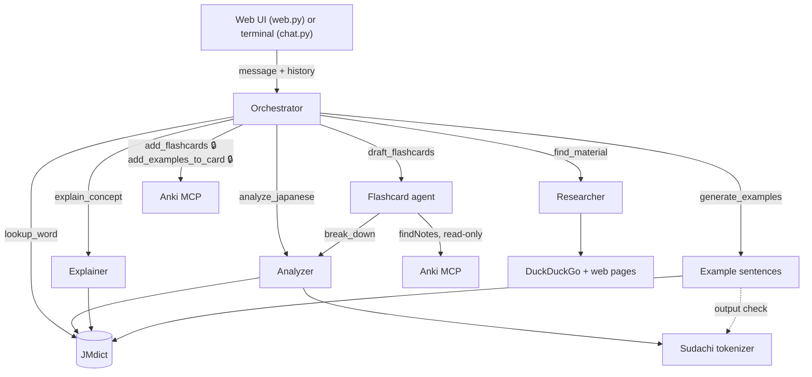

# Architecture

How a message travels through jplearn, and the pieces around it: approvals, live activity,
streaming and saved preferences.

## Overview

🔒 = the user must approve the call first. The web UI's **Agents** panel draws this same graph
live from [architecture.py](../src/jplearn/architecture.py).

- **Orchestrator** ([agents/orchestrator.py](../src/jplearn/agents/orchestrator.py)) is the only
  agent the user talks to. For each message it writes a short plan, calls specialists as
  tools, and returns `OrchestratorReply(plan, reply)`.
- **Specialists** are separate PydanticAI agents, each run from an orchestrator tool. They
  return structured data (a `Breakdown`, `Explanation`, `CardDraft`...) that the
  orchestrator turns into the reply. They share the orchestrator's token `usage`, so usage
  limits cover the whole turn. See [agents.md](agents.md).
- **Grounding tools** keep Japanese facts out of the model's guesswork: the SudachiPy
  tokenizer ([tokenizer.py](../src/jplearn/tokenizer.py)) gives readings, dictionary forms
  and parts of speech, and JMdict ([dictionary.py](../src/jplearn/dictionary.py)) gives
  meanings from a local SQLite database.
- **Anki** is reached through an MCP server ([anki.py](../src/jplearn/anki.py)) that `npx`
  starts and that talks to the AnkiConnect add-on. Drafting gets a filtered, read-only
  toolset; writes go through the approval flow below.
- **Every agent uses the same model**, from `get_model()` in
  [config.py](../src/jplearn/config.py): a LiteLLM proxy or the Claude API. See
  [configuration.md](configuration.md).

## One turn, step by step

1. The UI calls `orchestrator.run(user_prompt, message_history=history)`. The history is the
   PydanticAI message list from earlier turns, kept per browser tab (`gr.State`) or per
   terminal session.
2. The orchestrator plans, then calls tools. A specialist tool runs its own agent, which can
   call its own tools (e.g. Flashcard agent → Analyzer → tokenizer + JMdict).
3. The run ends one of two ways:
   - **A reply:** the UI shows a collapsed "How I answered" message (plan, specialists used,
     time taken), then the reply.
   - **An approval request:** see the next section.
4. The UI stores `result.all_messages()` as the new history.

## Approvals

Anything that writes to Anki is an orchestrator tool declared with
`@orchestrator.tool_plain(requires_approval=True)` (`add_flashcards`, `add_examples_to_card`).

1. When the model calls one, the run stops early and returns `DeferredToolRequests` instead of
   a reply.
2. The UI shows each pending call, formatted by `describe_approval()` (a table of the cards or
   sentences), and asks the user:
   - **Web:** Approve / Reject buttons. Typing a reply instead counts as a rejection, and the
     reply is passed to the model as the reason (`ToolDenied`), so "use the deck Travel
     instead" works.
   - **Terminal:** an `approve? [y/N]` prompt.
3. The UI runs the orchestrator again with `deferred_tool_results`. Approved calls execute;
   rejected ones return the denial to the model, which then replies.

To make another tool need approval, give it `requires_approval=True` and add its name to the
calling node's `approval` set in `architecture.py`, so the diagram shows the 🔒.

## Live activity (web UI)

[activity.py](../src/jplearn/activity.py) records what is happening during a turn, for the
**Agents** panel and its **Activity** log:

- Every agent has the `Observe` capability, a PydanticAI hook that logs its run, each LLM
  call (with token counts) and each tool call, and marks its node as running.
- Tool and MCP nodes mark themselves with `with track("jmdict"): ...`.
- Entries nest: anything inside an agent run or tool call is logged one level deeper.
  `tree_order()` keeps parallel tool calls from interleaving in the log.
- `web.py` runs the orchestrator inside `Activity.watch()`, which yields node statuses
  (`running`, `done`, `waiting`) whenever something changes, and the page re-renders.

Outside `watch()` (terminal chat, scripts) all of this is a no-op.

## Streaming replies (web UI)

The reply appears as the model writes it:

1. `web.py` passes `event_stream_handler=stream_reply(...)` to `orchestrator.run()`. The run
   still completes normally (tools, approvals); the handler only watches the model's output.
2. The reply is structured output, `{"plan": [...], "reply": "..."}`, so it arrives as JSON
   fragments: tool-call arguments through LiteLLM, or response text on the Claude API.
   `stream_reply` parses the partial JSON and passes the growing `reply` to `LiveReply`.
3. `LiveReply` stores the text and wakes `Activity.watch()` at most every 50 ms, so fast
   streams don't flood the browser.

The wait before a reply starts is usually the specialists working; their output is not
streamed, because it is data for the orchestrator. A "Working: Explainer · JMdict" spinner
shows what is running in the meantime.

## Saved preferences

[user_context.py](../src/jplearn/user_context.py) stores notes about the learner (level,
languages they know, formatting wishes) in `data/context.json`. Each note applies to all
agents or to one, and can be switched off without deleting it.

`use_user_context(agent, "<id>")` registers a dynamic instruction, so each agent re-reads the
enabled notes on every run and edits apply from the next message without a restart. The web
UI edits them under **Menu → Preferences**.

## Web UI layout

[web.py](../src/jplearn/web.py) builds a Gradio page with three areas:

- **Left sidebar:** new chat and Preferences.
- **Centre:** the conversation, the Approve/Reject buttons and the message box. The box is
  locked while a turn is running.
- **Right sidebar:** the Agents graph (tree or graph view) and the Activity log.

Styling lives in [theme.py](../src/jplearn/theme.py); the agents panel and log carry their
own CSS in `architecture.py` and `log_view.py`. Replies written with furigana in brackets,
like 食(た)べる, are shown with the reading above the kanji (`with_furigana()`).
