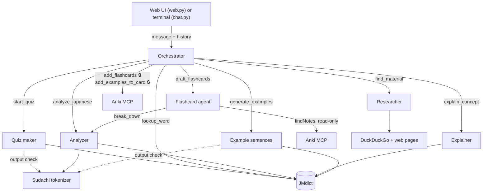

# Architecture

How a message travels through jplearn, and the pieces around it: approvals, live activity,
streaming and saved preferences.

## Overview

🔒 = the user must approve the call first. The web UI's **Agents** panel draws this same graph
live from [architecture.py](../src/jplearn/architecture.py).

- **Orchestrator** ([agents/orchestrator.py](../src/jplearn/agents/orchestrator.py)) is the only
  agent the user talks to. For each message it writes a short plan, calls specialists as
  tools, and returns `OrchestratorReply(plan, reply)`.
- **Specialists** are separate PydanticAI agents, each run from an orchestrator tool. They
  return structured data (a `Breakdown`, `Explanation`, `CardDraft`...) that the
  orchestrator turns into the reply. They share the orchestrator's token `usage`, so usage
  limits cover the whole turn. See [agents.md](agents.md).
- **Grounding tools** keep Japanese facts out of the model's guesswork: the SudachiPy
  tokenizer ([tokenizer.py](../src/jplearn/tokenizer.py)) gives readings, dictionary forms
  and parts of speech, and JMdict ([dictionary.py](../src/jplearn/dictionary.py)) gives
  meanings from a local SQLite database.
- **Anki** is reached through an MCP server ([anki.py](../src/jplearn/anki.py)) that `npx`
  starts and that talks to the AnkiConnect add-on. Drafting gets a filtered, read-only
  toolset; writes go through the approval flow below.
- **Every agent uses the same model**, from `get_model()` in
  [config.py](../src/jplearn/config.py): a LiteLLM proxy or the Claude API. See
  [configuration.md](configuration.md).

## One turn, step by step

1. The UI calls `orchestrator.run(user_prompt, message_history=history)`. The history is the
   PydanticAI message list from earlier turns, kept per browser tab (`gr.State`) or per
   terminal session.
2. The orchestrator plans, then calls tools. A specialist tool runs its own agent, which can
   call its own tools (e.g. Flashcard agent → Analyzer → tokenizer + JMdict).
3. The run ends one of two ways:
   - **A reply:** the UI shows a collapsed "How I answered" message (plan, specialists used,
     time taken), then the reply.
   - **An approval request:** see the next section.
4. The UI stores `result.all_messages()` as the new history.

## Approvals

Anything that writes to Anki is an orchestrator tool declared with
`@orchestrator.tool_plain(requires_approval=True)` (`add_flashcards`, `add_examples_to_card`).

1. When the model calls one, the run stops early and returns `DeferredToolRequests` instead of
   a reply.
2. The UI shows each pending call, formatted by `describe_approval()` (a table of the cards or
   sentences), and asks the user:
   - **Web:** Approve / Reject buttons. Typing a reply instead counts as a rejection, and the
     reply is passed to the model as the reason (`ToolDenied`), so "use the deck Travel
     instead" works.
   - **Terminal:** an `approve? [y/N]` prompt.
3. The UI runs the orchestrator again with `deferred_tool_results`. Approved calls execute;
   rejected ones return the denial to the model, which then replies.

To make another tool need approval, give it `requires_approval=True` and add its name to the
calling node's `approval` set in `architecture.py`, so the diagram shows the 🔒.

## Live activity (web UI)

[activity.py](../src/jplearn/activity.py) records what is happening during a turn, for the
**Agents** panel and its **Activity** log:

- Every agent has the `Observe` capability, a PydanticAI hook that logs its run, each LLM
  call (with token counts) and each tool call, and marks its node as running.
- Tool and MCP nodes mark themselves with `with track("jmdict"): ...`.
- Entries nest: anything inside an agent run or tool call is logged one level deeper.
  `tree_order()` keeps parallel tool calls from interleaving in the log.
- `web.py` runs the orchestrator inside `Activity.watch()`, which yields node statuses
  (`running`, `done`, `waiting`) whenever something changes, and the page re-renders.

Outside `watch()` (terminal chat, scripts) all of this is a no-op.

## Streaming replies (web UI)

The reply appears as the model writes it:

1. `web.py` passes `event_stream_handler=stream_reply(...)` to `orchestrator.run()`. The run
   still completes normally (tools, approvals); the handler only watches the model's output.
2. The reply is structured output, `{"plan": [...], "reply": "..."}`, so it arrives as JSON
   fragments: tool-call arguments through LiteLLM, or response text on the Claude API.
   `stream_reply` parses the partial JSON and passes the growing `reply` to `LiveReply`.
3. `LiveReply` stores the text and wakes `Activity.watch()` at most every 50 ms, so fast
   streams don't flood the browser.

The wait before a reply starts is usually the specialists working; their output is not
streamed, because it is data for the orchestrator. A "Working: Explainer · JMdict" spinner
shows what is running in the meantime.

## Saved preferences

[user_context.py](../src/jplearn/user_context.py) stores notes about the learner (level,
languages they know, formatting wishes) in `data/context.json`. Each note applies to all
agents or to one, and can be switched off without deleting it.

`use_user_context(agent, "<id>")` registers a dynamic instruction, so each agent re-reads the
enabled notes on every run and edits apply from the next message without a restart. The web
UI edits them under **Menu → Preferences**.

## Quizzes (web UI)

Asking to be quizzed ("quiz me on N5 verbs") opens a quiz panel under the chat. The pieces:

1. The orchestrator calls `start_quiz`, which runs the Quiz maker and returns the `Quiz` as
   tool-result **metadata**. Metadata stays in the chat history but is never sent to the
   model.
2. After each turn, `sync_quiz` in `web.py` looks for the latest unfinished quiz in the
   history (`quiz_view.active_quiz`) and opens the panel on question 1. The same step runs
   when a chat is opened or the page reloads, so an unfinished quiz comes back with its chat.
3. [quiz_view.py](../src/jplearn/quiz_view.py) keeps a `QuizSession` (which question, what
   was answered) in the tab's state and renders one question at a time with a progress bar.
   Choices are marked as soon as one is clicked; typed answers on Enter or **Check**. Each
   answer shows right/wrong and a short explanation straight away. No model call is needed
   for marking.
4. After the last question (**See results**), or on **End quiz**, the results go into the
   chat as the learner's message and to the orchestrator as a prompt starting with
   `[quiz <id> finished]`. The orchestrator replies with feedback on the mistakes. That
   marker also tells `active_quiz` the quiz is done, so it doesn't reopen.

## Read & translate (web UI)

The second tab, in [reader_view.py](../src/jplearn/reader_view.py), is for working through a
text yourself rather than chatting. It doesn't go through the orchestrator, and only checking
the translation calls a model; everything else comes from the tokenizer, JMdict and
[grammar_notes.py](../src/jplearn/grammar_notes.py).

1. **Start reading** shows the text (up to 1,000 characters) in the reading pane, a custom
   `gr.HTML` whose every piece of text is a span carrying its character offset (`data-s`).
   Hovering a word shows its reading. **🔊 Listen** under the text box reads the pane aloud,
   or only the part selected in it (see [Text to speech](#text-to-speech-web-ui)).
2. **Highlighting.** A key (default **H**, changeable with **Change key**, stored in the
   browser's localStorage) or the toolbar button toggles the highlighter cursor. The pane's
   script (`PANE_JS`, run by `js_on_load`) turns a mouse selection into code-point offsets
   and sends `trigger('select', {action: 'add', start, end})`; clicking a highlight sends
   `remove`. `on_select` snaps the selection to whole tokens (`add_highlight`), merging
   overlaps, and re-renders. The key is ignored while typing in a text box; Esc turns the
   highlighter off.
3. **Breakdown.** Each highlight is broken down straight away by `items_in()`, shown under
   step 3 (Study your highlights) so it doesn't sit between the text and the translation box. Content words
   get their dictionary form, reading and JMdict meaning (and the form used in the text);
   particles and auxiliaries get a note from `GRAMMAR_NOTES` (JMdict reads が as 画,
   "picture"); て + いる, しまう, みる... become one pattern from `TE_PATTERNS` (〜ている).
4. **Check my translation** runs the Translation checker
   ([translation.py](../src/jplearn/agents/translation.py)) with the text, a word list of it
   from the same breakdown (`word_list()`), the highlights and the learner's attempt. Each
   mistake quotes the part of the text it is about, which is then highlighted in red
   (`source="mistake"`), so it joins the breakdown, quiz and cards.

   **Offline mode** (the 🔌 checkbox) skips the model: the button becomes **Compare with
   the dictionary** and `self_check_markdown()` lists each word with whether one of its JMdict
   meanings appears in the translation (rough English stemming plus common irregular verbs),
   and the grammar points to check. The learner judges the ❔ rows and highlights what they
   missed. Every other step in the tab already works without a model.
5. **Quiz me** builds the quiz from the highlights without a model (`make_quiz()`): reading
   questions for words with kanji, meaning choices (wrong options are other words' meanings
   from the text), particles blanked out of their sentence, and pattern meanings (wrong
   options from the grammar notes). It is shown in the tab's own copy of the quiz panel
   (`quiz_view.panel()`) and marked by the usual `grade()`.
6. **Make flashcards** builds a card per highlighted item, with its sentence as the example.
   Nothing is written until **Add to Anki** is clicked; that click is the approval for
   exactly the cards in the preview.

## Practice (web UI)

The third tab, in [practice.py](../src/jplearn/practice.py), runs entirely in the browser:
a kanji writing canvas (hold **A** and move the mouse, or switch to click and drag; the key
is ignored while the tab is closed or a text box has focus) and a typing box with a
**🔊 Listen** bar to hear what you typed.

## Text to speech (web UI)

[speech.py](../src/jplearn/speech.py)'s `speak_bar()` is a `gr.HTML` whose script uses the
browser's Web Speech API (`speechSynthesis`), so it needs no Python package, model call or
server request. It reads the first visible element matching its CSS selectors (a textarea
by value, anything else by its text), or just the selected text inside it. Long text is
queued sentence by sentence, since some browsers cut off long utterances. The speed and
voice (Japanese voices only, natural/online ones first) are remembered in localStorage.
Voices come from the OS or browser: on Windows, add Japanese under Settings > Time &
language > Speech if none is listed.

## Saved chats (web UI)

[conversations.py](../src/jplearn/conversations.py) saves each web chat to
`data/chats/<id>.json` after every turn, so chats survive a page reload or an app restart.
Each file holds:

- `messages`: what the chat window shows.
- `history`: the PydanticAI message history, so the orchestrator remembers the conversation
  when you carry on.
- `pending`: ids of Anki writes still waiting for approval. On reopening, `pending_approvals()`
  rebuilds the approval request from the history, so Approve/Reject still work.

The left sidebar lists saved chats, newest first, titled with your first message. Opening
the page carries on with the most recent chat; **New chat** starts a fresh one, and **Delete
this chat** removes the open one. Saving runs as a separate Gradio step chained with
`.then()` after each turn.

Chats are not shared between agents or across chats: each conversation only remembers
itself. Lasting facts about the learner belong in Preferences. The terminal chat doesn't
save.

## Web UI layout

[web.py](../src/jplearn/web.py) builds a Gradio page with three areas:

- **Left sidebar:** new chat, saved chats, and Preferences.
- **Centre:** the conversation, the quiz panel (while a quiz is running), the
  Approve/Reject buttons and the message box. The box is locked while a turn is running.
- **Right sidebar:** the Agents graph (tree or graph view) and the Activity log.

Styling lives in [theme.py](../src/jplearn/theme.py); the agents panel and log carry their
own CSS in `architecture.py` and `log_view.py`. Replies written with furigana in brackets,
like 食(た)べる, are shown with the reading above the kanji (`with_furigana()`).
